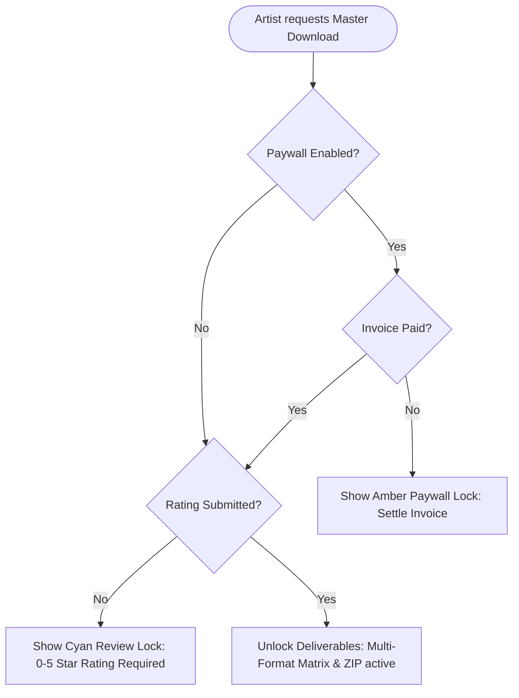

# Spectral Soundworks — Architecture & Technical Implementation Documentation

**Document**: System Architecture, Component Topology, and Engineering Specs  
**Version**: 2.0.0  
**Stack**: Next.js 16 (App Router), React 19 (Server & Client Components), Tailwind CSS v4, Prisma 7, PostgreSQL  
**Author**: System Architect & Swarm Director  
**Date**: 2026-10-25  

---

## 1. System Topology & Directory Layout

### 1.1 High-Level Component Topology

```
┌────────────────────────────────────────────────────────────────────────┐
│                          CLIENT (ARTIST BROWSER)                       │
│  - /portal/[token]                 (Main Portal: Player, Mix Sign-off) │
│  - /portal/[token]/invoice         (Invoice Checkout & Multi-Pay Modal)│
│  - /portal/[token]/history         (Project & Payment History Ledger)  │
│  - /portal/[token]/receipt/[id]    (Printable Payment Receipt)         │
└───────────────────────────────────┬────────────────────────────────────┘
                                    │ HTTPS (Cookie-less Token Auth)
                                    ▼
┌────────────────────────────────────────────────────────────────────────┐
│                        NEXT.JS 16 APP ROUTER (SERVER)                  │
│  ┌───────────────────────┐ ┌───────────────────────┐ ┌───────────────┐ │
│  │ Server Actions        │ │ API Route Handlers    │ │ RSC Data      │ │
│  │ - submitFeedback      │ │ - /api/portal/[token]/│ │ Fetching      │ │
│  │ - approveMixForMaster │ │   download/[fileId]   │ │ - Prisma 7    │ │
│  │ - submitRatingGate    │ │ - /api/portal/[token]/│ │   Typed Query │ │
│  │ - upsertProjectInvoice│ │   bundle              │ │               │ │
│  │ - recordInvoicePayment│ │ - /api/upload         │ │               │ │
│  └───────────────────────┘ └───────────────────────┘ └───────────────┘ │
└───────────────────────────────────┬────────────────────────────────────┘
                                    │ Prisma 7 (@prisma/adapter-pg)
                                    ▼
┌────────────────────────────────────────────────────────────────────────┐
│                           POSTGRESQL 16+ DATABASE                      │
│  - Project (mix approval, paywallDeliverables, rating, workflowStage)  │
│  - ProjectFile (category, format, sampleRate, waveformPeaks)           │
│  - ProjectFeedback (timestamp, authorRole, parentFeedbackId)           │
│  - ProjectInvoice (payment rails, status, templateId)                  │
│  - InvoiceTemplate (studio package presets)                            │
│  - ProjectActivityLog (lifecycle audit history)                        │
└────────────────────────────────────────────────────────────────────────┘
```

### 1.2 Target Directory Layout in `ss-app/src`

```
src/
├── app/
│   ├── api/
│   │   ├── portal/
│   │   │   └── [token]/
│   │   │       ├── bundle/
│   │   │       │   └── route.ts          <-- Dynamic ZIP streaming for multi-format downloads
│   │   └── download/
│   │       └── [fileId]/
│   │           └── route.ts              <-- Protected download proxy (Gate: Paywall + Rating)
│   │   └── upload/
│   │       └── route.ts                  <-- File uploader with waveform peak extraction
│   ├── portal/
│   │   └── [token]/
│   │       ├── actions.ts                <-- Portal server actions (Mix sign-off, Rating gate, Feedback)
│   │       ├── billing/
│   │       │   └── page.tsx              <-- Redirect / Alias to history
│   │       ├── history/
│   │       │   └── page.tsx              <-- Complete Artist Project & Payment History Ledger
│   │       ├── invoice/
│   │       │   ├── page.tsx              <-- Invoice view with "Pay Now" trigger
│   │       │   └── receipt/
│   │       │       └── [invoiceId]/
│   │       │           └── page.tsx      <-- Clean printable/downloadable receipt
│   │       ├── components/
│   │       │   ├── AudioWaveformPlayer.tsx <-- Interactive waveform with timestamped pins
│   │       │   ├── MixApprovalBanner.tsx   <-- Mix sign-off workflow & confirmation modal
│   │       │   ├── DeliverableGatedSection.tsx <-- Dual-gate (Paywall + Rating) unlocker
│   │       │   ├── MultiFormatFilterBar.tsx <-- Global Format (WAV/MP3) & Sample Rate (44.1/48k)
│   │       │   ├── PaymentMethodModal.tsx  <-- 5-rail checkout (Stripe, ApplePay, PayPal, Venmo, Chime)
│   │       │   ├── StarRatingModal.tsx     <-- Mandatory 0-5 star review collector
│   │       │   └── FeedbackForm.tsx
│   │       └── page.tsx                  <-- Main Client Portal Dashboard
│   └── projects/
│       ├── [id]/
│       │   ├── invoice/
│       │   │   └── page.tsx              <-- Studio engineer invoice builder with package presets
│       │   └── page.tsx                  <-- Studio engineer project command center
│       ├── actions.ts                    <-- Engineer actions (Paywall toggle, templates, status)
│       └── components/
│           ├── InvoiceEditor.tsx         <-- Package preset loader & custom invoice builder
│           ├── FileUploadArea.tsx        <-- Upload with Category, Format, SampleRate tagging
│           └── AudioPlayer.tsx
└── lib/
    ├── audio-peaks.ts                    <-- Normalized waveform peak extractor & generator
    ├── invoice-templates.ts              <-- Studio package preset definitions & line item models
    ├── invoice.ts                        <-- Money parsing & invoice totals calculation
    ├── prisma.ts                         <-- Prisma client singleton
    └── utils.ts                          <-- Time formatting [mm:ss], byte formatters
```

---

## 2. Core Architectural Subsystems

### 2.1 Audio Waveform Player & Timestamped Revision Engine
- **Waveform Extraction**:
  When an audio file is uploaded (`/api/upload`), the server extracts a lightweight array of 100-150 normalized peak floats `[0..1]`. If uncomputed, the client falls back to computing peaks on the first playback using `AudioContext.decodeAudioData` and caches it.
- **Waveform Rendering**:
  Rendered using an SVG path or Canvas bars (width: 3px, gap: 1.5px, radius: 1.5px). 
  - Past playback section rendered in cyan accent `#00f2ff`.
  - Future playback section rendered in muted translucent white `rgba(255,255,255,0.15)`.
- **Timestamp Marker Pins**:
  Revision comments with `timestamp != null` are positioned as absolute markers on the waveform track:
  ```typescript
  const leftPercent = (comment.timestamp / duration) * 100;
  ```
  Hovering reveals a sleek floating tooltip: `[01:24] "Vocal reverb tail too loud"`.
  Clicking any marker or comment in the revision list immediately invokes:
  ```typescript
  audioRef.current.currentTime = comment.timestamp;
  audioRef.current.play();
  setActiveCommentId(comment.id);
  ```
- **Separation Invariant**:
  The audio player must NEVER be rendered inside an `<a>` download anchor tag (correcting legacy DOM nesting errors).

### 2.2 Mix Approval for Mastering Workflow
- **State Machine**:
  ```mermaid
  stateDiagram-v2
      [*] --> IN_MIXING : Project Created
      IN_MIXING --> MIX_APPROVED : Artist signs off on Mix
      MIX_APPROVED --> IN_MASTERING : Engineer starts master chain
      IN_MASTERING --> MASTERED : Final Masters uploaded
      MASTERED --> COMPLETED : Invoice paid & Rating left
  ```
- **Sign-off Transaction**:
  When the artist clicks **"Approve Mix for Mastering"**, the server executes an atomic mutation:
  ```typescript
  await prisma.project.update({
    where: { id: projectId },
    data: {
      mixApprovedForMastering: true,
      mixApprovedAt: new Date(),
      mixApprovedBy: signerName,
      mixApprovalNotes: notes,
      workflowStage: "MIX_APPROVED",
      activityLogs: {
        create: {
          actorRole: "ARTIST",
          actorName: signerName,
          action: "MIX_APPROVED_FOR_MASTERING",
          metadata: { timestamp: new Date(), notes }
        }
      }
    }
  });
  ```
  The client portal UI dynamically transitions from an approval trigger to a certified sign-off badge with the signer's name and approval timestamp.

### 2.3 Dual-Gate Deliverable Authorization Engine
Final deliverables (Masters, Stems, Track Outs) are protected by a two-stage evaluation engine:



1. **Gate 1 (Financial Settlement)**:
   `isPaywallCleared = !project.paywallDeliverables || (project.invoice && project.invoice.paidAt !== null);`
2. **Gate 2 (Satisfaction Review)**:
   `isRatingCleared = project.rating !== null && project.ratingSubmittedAt !== null;`
3. **Master Rule**:
   `isDeliverableUnlocked = isPaywallCleared && isRatingCleared;`
4. **Server Proxy Protection (`/api/portal/[token]/download/[fileId]`)**:
   Downloads cannot be spoofed. The download route verifies `isDeliverableUnlocked` in PostgreSQL before streaming bytes or redirecting to storage.

### 2.4 Multi-Format Matrix & Batch Download ZIP Architecture
- **Global Selector Component** (`MultiFormatFilterBar.tsx`):
  Artists manage three filter dimensions simultaneously without re-selecting on every track:
  ```typescript
  type ActiveFilters = {
    category: "ALL" | FileCategory;
    format: "ALL" | "WAV" | "MP3";
    sampleRate: "ALL" | "SR_44_1_KHZ" | "SR_48_KHZ";
  };
  ```
- **Client Filtering**:
  ```typescript
  const visibleDeliverables = deliverables.filter((file) => {
    if (filters.category !== "ALL" && file.category !== filters.category) return false;
    if (filters.format !== "ALL" && file.format !== filters.format) return false;
    if (filters.sampleRate !== "ALL" && file.sampleRate !== filters.sampleRate) return false;
    return true;
  });
  ```
- **Dynamic Bundle Streaming (`/api/portal/[token]/bundle`)**:
  When the artist clicks **"Download All Filtered (ZIP)"**, the endpoint gathers all matched deliverable files for the project, checks authorization gates, streams a ZIP archive on the fly using `archiver` or `node:zlib`, and pipes it directly to the response with `Content-Disposition: attachment; filename="[Project_Name]_Deliverables.zip"`.

### 2.5 Multi-Rail Payment Integration & Studio Templates
- **Payment Method Selection Modal**:
  Triggered when the artist hits **"Pay Now"** on `/portal/[token]/invoice`:
  - **Stripe**: Redirects to `invoice.stripePaymentUrl` or opens Stripe hosted checkout.
  - **Apple Pay**: Express Pay via Stripe or direct merchant pass-through.
  - **PayPal**: Direct link to studio PayPal address with pre-filled amount.
  - **Venmo**: Displays studio Venmo handle, QR code, and mobile deep link: `venmo://paycharge?txn=pay&recipients=${venmoHandle}&amount=${total}&note=${invoiceNumber}`.
  - **Chime**: Displays Chime sign-tag (`$SpectralSoundworks`), routing/account reference, and manual payment confirmation button.
- **Studio Invoice Package Templates**:
  Stored in `InvoiceTemplate` table and defined in code (`src/lib/invoice-templates.ts`):
  1. `MIX_SINGLE`: Single Track Mix ($300.00).
  2. `MASTER_SINGLE`: Single Track Master ($85.00).
  3. `MIX_MASTER_SINGLE`: Mix & Master Package ($375.00).
  4. `EP_PACKAGE`: 5-Song EP Mix & Master ($1,400.00).
  5. `ALBUM_PACKAGE`: 10-12 Track Album Package ($2,650.00).
  6. `CUSTOM`: Blank custom builder.
  In `/projects/[id]/invoice`, selecting a template instantly hydrates line items into the form.

### 2.6 Artist Project & Payment History Ledger
- Located at `/portal/[token]/history` (with `/portal/[token]/billing` acting as an alias).
- **Queries**:
  Finds the current project via `portalToken`, extracts `artistId`, and retrieves:
  1. All projects for `artistId` ordered by `createdAt desc`.
  2. All invoices for `artistId` with paid/unpaid status and itemized line items.
  3. Full lifecycle timeline showing all `ProjectActivityLog` records.
- **Printable Payment Receipts**:
  Available at `/portal/[token]/invoice/receipt/[invoiceId]`:
  - Clean, studio-branded monochrome aesthetic suitable for tax deduction and management records.
  - Contains Studio details, Artist details, Invoice #, Date Paid, Payment Method used, line items breakdown, total cents, and verification watermark.

---

## 3. Architecture Decision Records (ADRs)

### ADR-001: Precomputed Waveform Peaks vs Client-Side Web Audio Decoding
- **Context**: Decoding full 100MB 24-bit 48kHz WAV files on mobile browsers via `AudioContext.decodeAudioData` freezes UI threads and wastes mobile battery.
- **Decision**: Precompute 100 normalized float peaks `[0..1]` during upload and persist in `ProjectFile.waveformPeaks` JSONB. If uncomputed, decode lazily on client and cache.
- **Consequences**: Instantaneous waveform rendering (<50ms) on any device without waiting for the complete multi-megabyte audio file to buffer.

### ADR-002: Dual-Gate Deliverable Authorization Engine
- **Context**: Engineers suffer from unpaid deliverable downloads and failure to collect portfolio reviews after delivery.
- **Decision**: Chain two sequential conditional gates: Gate 1 (Invoice Paid if `paywallDeliverables = true`) and Gate 2 (Mandatory 0-5 Star Rating).
- **Consequences**: Guarantees zero revenue loss and 100% review capture rate while giving engineers flexibility to disable the paywall for pro-bono or pre-paid clients.

### ADR-003: Multi-Rail Payment Architecture (Stripe + P2P Rails)
- **Context**: Independent artists and underground producers in hip-hop, electronic, and indie rock frequently pay via Venmo, PayPal, or Chime rather than corporate credit cards.
- **Decision**: Support hybrid settlement: automated Stripe/Apple Pay cards alongside peer-to-peer instructions (Venmo, PayPal, Chime) with manual or webhook confirmation and receipt generation.
- **Consequences**: Slashes payment friction, accelerates time-to-settlement, and maintains accurate accounting in `ProjectInvoice`.

### ADR-004: Global Filter Matrix with Sticky State
- **Context**: Projects frequently contain 30+ deliverable files (WAV 44.1, WAV 48, MP3 320, Instrumentals, Acapellas, Drum Stems). Selecting format per file is tedious and prone to artist error.
- **Decision**: Global Segmented Filter Bar above the deliverables list with tabs for Category, Format, and Sample Rate, plus a "Download All Filtered" batch action.
- **Consequences**: Artist sets format once (e.g. WAV 48kHz) and views/downloads exactly what they need in one click.
