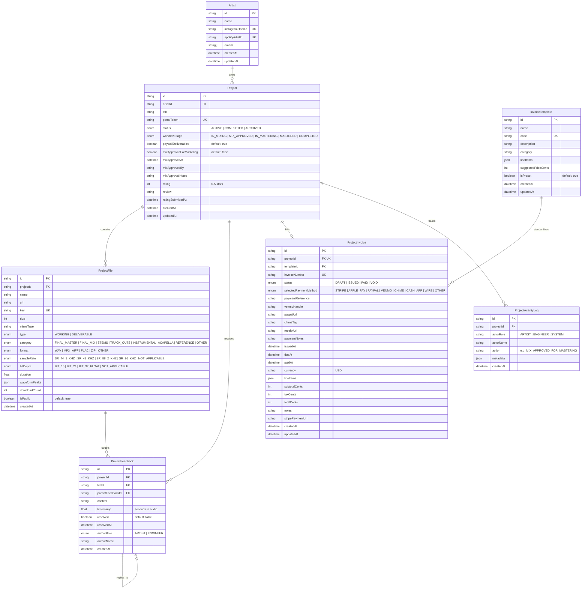

# Entity Relationship Diagram (ERD) & Database Schema Specification

**Project**: Spectral Soundworks — Client Project Portal & Invoicing  
**Schema Version**: 2.0.0  
**Target Engine**: PostgreSQL 16+ via Prisma 7 (`@prisma/adapter-pg`)  
**Date**: 2026-10-25  

---

## 1. Domain Entities & Bounded Contexts

```
┌────────────────────────────────────────────────────────────────────────┐
│                        ARTIST & CRM CONTEXT                            │
│  [Artist] ──── has_many ───► [Project]                                 │
└──────────────────────────────────┬─────────────────────────────────────┘
                                   │
                                   ▼
┌────────────────────────────────────────────────────────────────────────┐
│                        PROJECT WORKFLOW CONTEXT                        │
│  [Project] ──── has_many ───► [ProjectFile]                            │
│     │      ──── has_many ───► [ProjectFeedback]                        │
│     │      ──── has_one  ───► [ProjectInvoice]                         │
│     │      ──── has_many ───► [ProjectActivityLog]                     │
└──────────────────────────────────┬─────────────────────────────────────┘
                                   │
                                   ▼
┌────────────────────────────────────────────────────────────────────────┐
│                        INVOICING & PAYMENT CONTEXT                     │
│  [InvoiceTemplate] ──── has_many ───► [ProjectInvoice]                 │
└────────────────────────────────────────────────────────────────────────┘
```

---

## 2. Mermaid Entity Relationship Diagram



---

## 3. Exact Prisma Schema Extensions (`prisma/schema.prisma`)

Below is the concrete drop-in Prisma 7 schema configuration extending `Project`, `ProjectFile`, `ProjectFeedback`, `ProjectInvoice`, and adding `InvoiceTemplate` and `ProjectActivityLog`.

```prisma
// ==========================================
// ENUMS FOR WORKFLOW, AUDIO, AND INVOICING
// ==========================================

enum ProjectWorkflowStage {
  IN_MIXING
  MIX_APPROVED
  IN_MASTERING
  MASTERED
  COMPLETED
}

enum FileCategory {
  FINAL_MASTER
  FINAL_MIX
  STEMS
  TRACK_OUTS
  INSTRUMENTAL
  ACAPELLA
  REFERENCE
  OTHER
}

enum AudioFormat {
  WAV
  MP3
  AIFF
  FLAC
  ZIP
  OTHER
}

enum SampleRate {
  SR_44_1_KHZ  // 44,100 Hz (Streaming & CD Standard)
  SR_48_KHZ    // 48,000 Hz (Film, TV & Broadcast Standard)
  SR_88_2_KHZ  // 88,200 Hz (Audiophile / Hi-Res)
  SR_96_KHZ    // 96,000 Hz (Studio Hi-Res Standard)
  NOT_APPLICABLE
}

enum BitDepth {
  BIT_16       // 16-Bit Dithered
  BIT_24       // 24-Bit Studio Standard
  BIT_32_FLOAT // 32-Bit Floating Point
  NOT_APPLICABLE
}

enum FeedbackAuthorRole {
  ARTIST
  ENGINEER
}

enum PaymentMethod {
  STRIPE
  APPLE_PAY
  PAYPAL
  VENMO
  CHIME
  CASH_APP
  WIRE
  OTHER
}

enum InvoiceStatus {
  DRAFT
  ISSUED
  PAID
  VOID
}

// ==========================================
// UPDATED PROJECT MODEL
// ==========================================

model Project {
  id                      String               @id @default(cuid())
  artistId                String
  title                   String?              // e.g. "Neon Horizon EP - Track 01"
  portalToken             String               @unique @default(cuid())
  status                  ProjectStatus        @default(ACTIVE)
  workflowStage           ProjectWorkflowStage @default(IN_MIXING)

  // Gating & Deliverable Controls
  paywallDeliverables     Boolean              @default(true)
  
  // Official Mix Approval for Mastering Sign-off
  mixApprovedForMastering Boolean              @default(false)
  mixApprovedAt           DateTime?
  mixApprovedBy           String?              // Name or email of signer
  mixApprovalNotes        String?              // Optional notes left during sign-off

  // Mandatory Feedback & 0-5 Star Rating Gate
  rating                  Int?                 // 0-5 star rating
  review                  String?              // Optional client review/testimonial
  ratingSubmittedAt       DateTime?

  createdAt               DateTime             @default(now())
  updatedAt               DateTime             @updatedAt

  artist                  Artist               @relation(fields: [artistId], references: [id], onDelete: Cascade)
  files                   ProjectFile[]
  feedbacks               ProjectFeedback[]
  invoice                 ProjectInvoice?
  activityLogs            ProjectActivityLog[]

  @@index([artistId])
  @@index([portalToken])
  @@index([status, workflowStage])
}

// ==========================================
// UPDATED PROJECT FILE MODEL
// ==========================================

model ProjectFile {
  id            String       @id @default(cuid())
  projectId     String
  name          String
  url           String       // E.g., '/uploads/...' or S3 Presigned URL
  key           String       @unique // Unique storage key
  size          Int          // Size in bytes
  mimeType      String       // E.g., 'audio/wav', 'audio/mpeg', 'application/zip'
  type          FileType     @default(WORKING) // WORKING | DELIVERABLE

  // Multi-Format Classification
  category      FileCategory @default(OTHER)
  format        AudioFormat  @default(WAV)
  sampleRate    SampleRate   @default(SR_44_1_KHZ)
  bitDepth      BitDepth     @default(BIT_24)

  // Audio Playback & Waveform Engine
  duration      Float?       // Duration in seconds
  waveformPeaks Json?        // Normalized float array [0..1] (e.g. 100 points) for instant waveform render
  downloadCount Int          @default(0)

  isPublic      Boolean      @default(true)
  createdAt     DateTime     @default(now())

  project       Project      @relation(fields: [projectId], references: [id], onDelete: Cascade)
  feedbacks     ProjectFeedback[]

  @@index([projectId, type])
  @@index([category, format, sampleRate])
}

// ==========================================
// UPDATED PROJECT FEEDBACK MODEL
// ==========================================

model ProjectFeedback {
  id               String             @id @default(cuid())
  projectId        String
  fileId           String?
  parentFeedbackId String?            // For threaded replies
  content          String             // Revision request content
  timestamp        Float?             // Exact timestamp in seconds (e.g. 84.5s)
  resolved         Boolean            @default(false)
  resolvedAt       DateTime?
  authorRole       FeedbackAuthorRole @default(ARTIST)
  authorName       String?            // Display name of comment author
  createdAt        DateTime           @default(now())

  project          Project            @relation(fields: [projectId], references: [id], onDelete: Cascade)
  file             ProjectFile?       @relation(fields: [fileId], references: [id], onDelete: Cascade)
  parentFeedback   ProjectFeedback?   @relation("FeedbackReplies", fields: [parentFeedbackId], references: [id], onDelete: Cascade)
  replies          ProjectFeedback[]  @relation("FeedbackReplies")

  @@index([projectId, fileId])
  @@index([timestamp])
}

// ==========================================
// UPDATED INVOICE MODEL WITH MULTI-METHOD
// ==========================================

model ProjectInvoice {
  id                    String         @id @default(cuid())
  projectId             String         @unique
  templateId            String?
  invoiceNumber         String         @unique
  status                InvoiceStatus  @default(ISSUED)
  issuedAt              DateTime       @default(now())
  dueAt                 DateTime?
  paidAt                DateTime?
  currency              String         @default("USD")
  lineItems             Json           // Array of { description, quantity, unitPriceCents, amountCents }
  subtotalCents         Int
  taxCents              Int            @default(0)
  totalCents            Int
  notes                 String?

  // Payment rails & manual settlement details
  selectedPaymentMethod PaymentMethod?
  paymentReference      String?        // Transaction hash, PayPal order ID, or bank reference
  stripePaymentUrl      String?
  venmoHandle           String?        // Studio Venmo handle
  paypalUrl             String?        // Studio PayPal link
  chimeTag              String?        // Studio Chime tag
  receiptUrl            String?        // Generated PDF or HTML receipt path
  paymentNotes          String?

  createdAt             DateTime       @default(now())
  updatedAt             DateTime       @updatedAt

  project               Project        @relation(fields: [projectId], references: [id], onDelete: Cascade)
  template              InvoiceTemplate? @relation(fields: [templateId], references: [id], onDelete: SetNull)

  @@index([status])
  @@index([paidAt])
}

// ==========================================
// PRE-POPULATED INVOICE TEMPLATES
// ==========================================

model InvoiceTemplate {
  id                 String           @id @default(cuid())
  name               String           // e.g. "Mix & Master Single Package"
  code               String           @unique // e.g. "MIX_MASTER_SINGLE"
  description        String
  category           String           // e.g. "PACKAGES", "MIXING", "MASTERING"
  lineItems          Json             // Default line items
  suggestedPriceCents Int
  isPreset           Boolean          @default(true)
  createdAt          DateTime         @default(now())
  updatedAt          DateTime         @updatedAt

  invoices           ProjectInvoice[]

  @@index([code])
}

// ==========================================
// PROJECT LIFECYCLE ACTIVITY LOG (AUDIT)
// ==========================================

model ProjectActivityLog {
  id        String   @id @default(cuid())
  projectId String
  actorRole String   // 'ARTIST', 'ENGINEER', 'SYSTEM'
  actorName String?
  action    String   // 'MIX_APPROVED_FOR_MASTERING', 'INVOICE_PAID', 'RATING_SUBMITTED', etc.
  metadata  Json?    // Context payload
  createdAt DateTime @default(now())

  project   Project  @relation(fields: [projectId], references: [id], onDelete: Cascade)

  @@index([projectId, createdAt])
}
```

---

## 4. PostgreSQL DDL Migration SQL

```sql
-- 1. Create Enums
CREATE TYPE "ProjectWorkflowStage" AS ENUM ('IN_MIXING', 'MIX_APPROVED', 'IN_MASTERING', 'MASTERED', 'COMPLETED');
CREATE TYPE "FileCategory" AS ENUM ('FINAL_MASTER', 'FINAL_MIX', 'STEMS', 'TRACK_OUTS', 'INSTRUMENTAL', 'ACAPELLA', 'REFERENCE', 'OTHER');
CREATE TYPE "AudioFormat" AS ENUM ('WAV', 'MP3', 'AIFF', 'FLAC', 'ZIP', 'OTHER');
CREATE TYPE "SampleRate" AS ENUM ('SR_44_1_KHZ', 'SR_48_KHZ', 'SR_88_2_KHZ', 'SR_96_KHZ', 'NOT_APPLICABLE');
CREATE TYPE "BitDepth" AS ENUM ('BIT_16', 'BIT_24', 'BIT_32_FLOAT', 'NOT_APPLICABLE');
CREATE TYPE "FeedbackAuthorRole" AS ENUM ('ARTIST', 'ENGINEER');
CREATE TYPE "PaymentMethod" AS ENUM ('STRIPE', 'APPLE_PAY', 'PAYPAL', 'VENMO', 'CHIME', 'CASH_APP', 'WIRE', 'OTHER');
CREATE TYPE "InvoiceStatus" AS ENUM ('DRAFT', 'ISSUED', 'PAID', 'VOID');

-- 2. Alter Project Table
ALTER TABLE "Project"
  ADD COLUMN "workflowStage" "ProjectWorkflowStage" NOT NULL DEFAULT 'IN_MIXING',
  ADD COLUMN "paywallDeliverables" BOOLEAN NOT NULL DEFAULT true,
  ADD COLUMN "mixApprovedForMastering" BOOLEAN NOT NULL DEFAULT false,
  ADD COLUMN "mixApprovedAt" TIMESTAMP(3),
  ADD COLUMN "mixApprovedBy" TEXT,
  ADD COLUMN "mixApprovalNotes" TEXT,
  ADD COLUMN "ratingSubmittedAt" TIMESTAMP(3);

CREATE INDEX "Project_artistId_idx" ON "Project"("artistId");
CREATE INDEX "Project_portalToken_idx" ON "Project"("portalToken");
CREATE INDEX "Project_status_workflowStage_idx" ON "Project"("status", "workflowStage");

-- 3. Alter ProjectFile Table
ALTER TABLE "ProjectFile"
  ADD COLUMN "category" "FileCategory" NOT NULL DEFAULT 'OTHER',
  ADD COLUMN "format" "AudioFormat" NOT NULL DEFAULT 'WAV',
  ADD COLUMN "sampleRate" "SampleRate" NOT NULL DEFAULT 'SR_44_1_KHZ',
  ADD COLUMN "bitDepth" "BitDepth" NOT NULL DEFAULT 'BIT_24',
  ADD COLUMN "duration" DOUBLE PRECISION,
  ADD COLUMN "waveformPeaks" JSONB,
  ADD COLUMN "downloadCount" INTEGER NOT NULL DEFAULT 0;

CREATE INDEX "ProjectFile_projectId_type_idx" ON "ProjectFile"("projectId", "type");
CREATE INDEX "ProjectFile_category_format_sampleRate_idx" ON "ProjectFile"("category", "format", "sampleRate");

-- 4. Alter ProjectFeedback Table
ALTER TABLE "ProjectFeedback"
  ADD COLUMN "parentFeedbackId" TEXT,
  ADD COLUMN "resolvedAt" TIMESTAMP(3),
  ADD COLUMN "authorRole" "FeedbackAuthorRole" NOT NULL DEFAULT 'ARTIST',
  ADD COLUMN "authorName" TEXT;

ALTER TABLE "ProjectFeedback"
  ADD CONSTRAINT "ProjectFeedback_parentFeedbackId_fkey"
  FOREIGN KEY ("parentFeedbackId") REFERENCES "ProjectFeedback"("id") ON DELETE CASCADE ON UPDATE CASCADE;

CREATE INDEX "ProjectFeedback_projectId_fileId_idx" ON "ProjectFeedback"("projectId", "fileId");
CREATE INDEX "ProjectFeedback_timestamp_idx" ON "ProjectFeedback"("timestamp");

-- 5. Create InvoiceTemplate Table
CREATE TABLE "InvoiceTemplate" (
  "id" TEXT NOT NULL PRIMARY KEY,
  "name" TEXT NOT NULL,
  "code" TEXT NOT NULL UNIQUE,
  "description" TEXT NOT NULL,
  "category" TEXT NOT NULL,
  "lineItems" JSONB NOT NULL,
  "suggestedPriceCents" INTEGER NOT NULL,
  "isPreset" BOOLEAN NOT NULL DEFAULT true,
  "createdAt" TIMESTAMP(3) NOT NULL DEFAULT CURRENT_TIMESTAMP,
  "updatedAt" TIMESTAMP(3) NOT NULL DEFAULT CURRENT_TIMESTAMP
);

CREATE INDEX "InvoiceTemplate_code_idx" ON "InvoiceTemplate"("code");

-- 6. Alter ProjectInvoice Table
ALTER TABLE "ProjectInvoice"
  ADD COLUMN "templateId" TEXT,
  ADD COLUMN "status" "InvoiceStatus" NOT NULL DEFAULT 'ISSUED',
  ADD COLUMN "selectedPaymentMethod" "PaymentMethod",
  ADD COLUMN "paymentReference" TEXT,
  ADD COLUMN "venmoHandle" TEXT,
  ADD COLUMN "paypalUrl" TEXT,
  ADD COLUMN "chimeTag" TEXT,
  ADD COLUMN "receiptUrl" TEXT,
  ADD COLUMN "paymentNotes" TEXT;

ALTER TABLE "ProjectInvoice"
  ADD CONSTRAINT "ProjectInvoice_templateId_fkey"
  FOREIGN KEY ("templateId") REFERENCES "InvoiceTemplate"("id") ON DELETE SET NULL ON UPDATE CASCADE;

CREATE INDEX "ProjectInvoice_status_idx" ON "ProjectInvoice"("status");
CREATE INDEX "ProjectInvoice_paidAt_idx" ON "ProjectInvoice"("paidAt");

-- 7. Create ProjectActivityLog Table
CREATE TABLE "ProjectActivityLog" (
  "id" TEXT NOT NULL PRIMARY KEY,
  "projectId" TEXT NOT NULL,
  "actorRole" TEXT NOT NULL,
  "actorName" TEXT,
  "action" TEXT NOT NULL,
  "metadata" JSONB,
  "createdAt" TIMESTAMP(3) NOT NULL DEFAULT CURRENT_TIMESTAMP,
  CONSTRAINT "ProjectActivityLog_projectId_fkey" FOREIGN KEY ("projectId") REFERENCES "Project"("id") ON DELETE CASCADE ON UPDATE CASCADE
);

CREATE INDEX "ProjectActivityLog_projectId_createdAt_idx" ON "ProjectActivityLog"("projectId", "createdAt");

-- 8. Seed Default Studio Package Templates
INSERT INTO "InvoiceTemplate" ("id", "name", "code", "description", "category", "lineItems", "suggestedPriceCents", "isPreset", "createdAt", "updatedAt") VALUES
('tmpl_mix_single', 'Single Track Mix', 'MIX_SINGLE', 'Complete multi-track mix up to 48 stems with 3 revision cycles.', 'MIXING', '[{"description": "Single Track Mixing (up to 48 stems)", "quantity": 1, "unitPriceCents": 30000, "amountCents": 30000}, {"description": "3 Revision Passes Included", "quantity": 1, "unitPriceCents": 0, "amountCents": 0}]', 30000, true, NOW(), NOW()),
('tmpl_master_single', 'Single Track Master', 'MASTER_SINGLE', 'Stereo master prepared for streaming (Apple Music/Spotify) and CD.', 'MASTERING', '[{"description": "Stereo Mastering (WAV 44.1kHz/48kHz + 320k MP3)", "quantity": 1, "unitPriceCents": 8500, "amountCents": 8500}]', 8500, true, NOW(), NOW()),
('tmpl_mix_master_single', 'Mix & Master Single Package', 'MIX_MASTER_SINGLE', 'Full mix and master with instrumental, acapella, and stem archives.', 'PACKAGES', '[{"description": "Full Multitrack Mix & Revisions", "quantity": 1, "unitPriceCents": 29000, "amountCents": 29000}, {"description": "Final Stereo Master (44.1kHz / 48kHz WAV)", "quantity": 1, "unitPriceCents": 6000, "amountCents": 6000}, {"description": "Stem Archive & Performance Mixes (Instrumental/TV Track)", "quantity": 1, "unitPriceCents": 2500, "amountCents": 2500}]', 37500, true, NOW(), NOW()),
('tmpl_ep_package', 'EP Production Package (4-5 Songs)', 'EP_PACKAGE', 'Discounted 5-song EP mixing and mastering bundle.', 'PACKAGES', '[{"description": "EP Mixing (5 Tracks)", "quantity": 5, "unitPriceCents": 22000, "amountCents": 110000}, {"description": "EP Mastering (5 Tracks - 44.1/48kHz WAV + MP3)", "quantity": 5, "unitPriceCents": 6000, "amountCents": 30000}]', 140000, true, NOW(), NOW()),
('tmpl_album_package', 'Full Album Package (10-12 Songs)', 'ALBUM_PACKAGE', 'Complete album mixing, sequencing, mastering, and DDP image creation.', 'PACKAGES', '[{"description": "Album Mixing (10 Tracks)", "quantity": 10, "unitPriceCents": 20000, "amountCents": 200000}, {"description": "Album Mastering & Loudness Matching (10 Tracks)", "quantity": 10, "unitPriceCents": 5000, "amountCents": 50000}, {"description": "DDP Image & Production Metadata Encoding", "quantity": 1, "unitPriceCents": 15000, "amountCents": 15000}]', 265000, true, NOW(), NOW());
```
